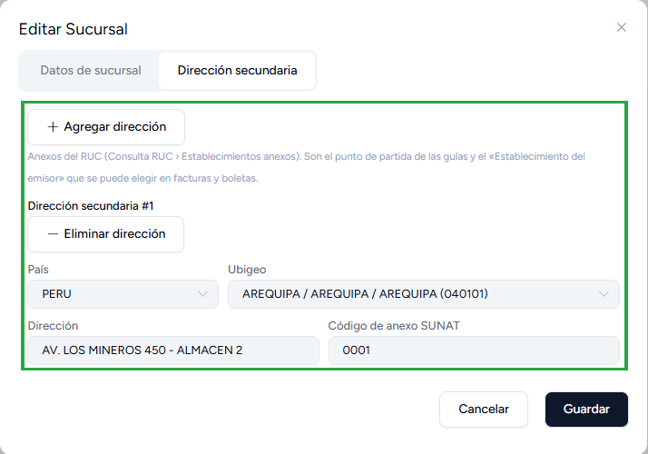

# Establecimiento del emisor: facturar desde un anexo del RUC

Una empresa puede tener, además de su domicilio fiscal, **establecimientos anexos** declarados en
su RUC: un almacén, una obra, una mina o un local en otra ciudad. Cuando el bien se entrega o el servicio
se presta en uno de esos anexos, la factura puede indicarlo. Es lo mismo que el portal de SUNAT pide como
«Indique el Establecimiento del Emisor donde entregue el bien o preste el servicio».

El comprobante conserva el **domicilio fiscal en la cabecera** y añade el anexo aparte:

- en el **PDF**, como la fila «Establecimiento del emisor»;
- en el **XML**, en `cac:SellerSupplierParty`, el mismo nodo que usa el portal de SUNAT.

Vale para **facturas y boletas** (`01` y `03`) en `POST /api/documents` y en
`POST /api/offline/sync-batch`. No cambia la serie, el almacén ni la caja del comprobante: solo añade el dato.

## En tres pasos

1. **Registrar los anexos**, una sola vez, en el panel del Facturador.
2. **Consultarlos** con `GET /api/establishments/annexes` y guardar el código de cada uno en tu sistema.
3. **Emitir** con `"establecimiento_del_emisor": { "codigo": "0001" }`.

## 1. Registrar los anexos (en el panel)

Los anexos se registran en el panel. **No hay un endpoint para crearlos.**

1. Entra a **Configuración y más → Sucursales & series**.
2. Edita el **establecimiento del usuario cuyo token usa tu integración** (el botón del lápiz).
3. Abre la pestaña **Dirección secundaria** y pulsa **Agregar dirección**.
4. Completa:
   - **País** y **Ubigeo** del anexo;
   - **Dirección**, tal como figura en el RUC;
   - **Código de anexo SUNAT**: el código de cuatro dígitos del anexo, que aparece en Consulta RUC →
     Establecimientos anexos (por ejemplo `0001`).
5. Pulsa **Guardar**.



:::info Los anexos son de un establecimiento
La API solo ofrece las direcciones secundarias **activas** del establecimiento del usuario dueño del token.
Si tu integración emite con usuarios de varios establecimientos, registra los anexos en cada uno.
:::

Estas mismas direcciones son el punto de partida que se puede elegir en las guías de remisión del panel.
El detalle de la pantalla está en
[Sucursales & series → Dirección secundaria](../../modulos/configuracion-y-mas/sucursales-series/crear-sucursales-y-gestionar-series.md#dirección-secundaria-anexos-del-ruc).

## 2. Consultar los anexos: `GET /api/establishments/annexes`

Con el mismo token de emisión:

```bash
curl -s https://tu-dominio.com/api/establishments/annexes \
  -H "Authorization: Bearer <TU_TOKEN>" \
  -H "Accept: application/json"
```

Respuesta:

```json
{
  "success": true,
  "establishment": {
    "id": 1,
    "codigo": "0000",
    "descripcion": "Oficina Principal",
    "direccion": "AV. PRINCIPAL 100"
  },
  "data": [
    {
      "id": 6,
      "codigo": "0001",
      "direccion": "AV. LOS MINEROS 450 - ALMACEN 2",
      "ubigeo": "040101",
      "departamento": "AREQUIPA",
      "provincia": "Arequipa",
      "distrito": "Arequipa"
    }
  ]
}
```

| Campo | Qué es |
|---|---|
| `establishment` | El establecimiento del token. Su dirección es la que va en la cabecera del comprobante. |
| `data[].codigo` | Código de anexo SUNAT. **Es lo que se manda al emitir.** |
| `data[].id` | Id de la dirección secundaria. Solo hace falta si dos direcciones tienen el mismo código. |
| `data[].direccion`, `ubigeo`, `departamento`, `provincia`, `distrito` | Lo que saldrá en el PDF y en el XML. |

**Cómo usarlo en tu sistema:**

- Llámalo al **configurar la integración** (o cuando cambien los anexos) y relaciona cada local o centro de
  costo de tu sistema con el `codigo` del anexo que le corresponde.
- Usa el **`codigo` como identificador**: es el de SUNAT, no cambia y lo ves también en Consulta RUC.
- Si `data` viene vacío, ese establecimiento no tiene anexos registrados: haz el paso 1.
- Si dos filas comparten `codigo`, manda el `id` de la que corresponda.

## 3. Emitir con el anexo

Se agrega el bloque `establecimiento_del_emisor` al JSON de siempre. El resto del comprobante no cambia.

```json
{
  "serie_documento": "F001",
  "numero_documento": "#",
  "fecha_de_emision": "2026-10-13",
  "hora_de_emision": "10:00:00",
  "codigo_tipo_operacion": "0101",
  "codigo_tipo_documento": "01",
  "codigo_tipo_moneda": "PEN",
  "fecha_de_vencimiento": "2026-10-13",
  "establecimiento_del_emisor": {
    "codigo": "0001"
  },
  "datos_del_cliente_o_receptor": {
    "codigo_tipo_documento_identidad": "6",
    "numero_documento": "20100066603",
    "apellidos_y_nombres_o_razon_social": "CLIENTE DE PRUEBA S.A.C.",
    "codigo_pais": "PE",
    "ubigeo": "150101",
    "direccion": "AV. PRUEBA 123"
  },
  "totales": {
    "total_operaciones_gravadas": 100.00,
    "total_igv": 18.00,
    "total_impuestos": 18.00,
    "total_valor": 100.00,
    "total_venta": 118.00
  },
  "items": [
    {
      "codigo_interno": "SRV-001",
      "descripcion": "SERVICIO DE CHANCADO DE MINERAL",
      "unidad_de_medida": "ZZ",
      "cantidad": 1,
      "valor_unitario": 100.00,
      "codigo_tipo_precio": "01",
      "precio_unitario": 118.00,
      "codigo_tipo_afectacion_igv": "10",
      "total_base_igv": 100.00,
      "porcentaje_igv": 18,
      "total_igv": 18.00,
      "total_impuestos": 18.00,
      "total_valor_item": 100.00,
      "total_item": 118.00
    }
  ]
}
```

- `"codigo": "1"` y `"codigo": "0001"` valen lo mismo.
- Con `id` en vez de código: `"establecimiento_del_emisor": { "id": 6 }`. Si mandas los dos, tienen que ser
  del mismo anexo.
- Para una **boleta** es igual, con `"codigo_tipo_documento": "03"` y su serie.
- Si no mandas el bloque, o lo mandas en `null`, el comprobante sale como siempre.
- Si mandas el código del **propio establecimiento** (el `establishment.codigo`, por ejemplo `"0000"`), el
  comprobante sale sin anexo y sin error. Así puedes enviar siempre el código del local que vende.

La respuesta es la de cualquier emisión: `external_id`, enlaces al XML, PDF y CDR, etc.

## Qué sale en el comprobante

**PDF** (A4, A5 y tickets): debajo de los datos del cliente aparece la fila

> ESTABLECIMIENTO DEL EMISOR: AV. LOS MINEROS 450 - ALMACEN 2, AREQUIPA, AREQUIPA - AREQUIPA

La cabecera sigue mostrando el domicilio fiscal del establecimiento.

**XML firmado**: después de los datos del cliente (`cac:AccountingCustomerParty`) va:

```xml
<cac:SellerSupplierParty>
  <cac:Party>
    <cac:PostalAddress>
      <cbc:ID>040101</cbc:ID>
      <cbc:CityName>Arequipa</cbc:CityName>
      <cbc:CountrySubentity>AREQUIPA</cbc:CountrySubentity>
      <cbc:District>Arequipa</cbc:District>
      <cac:AddressLine>
        <cbc:Line><![CDATA[AV. LOS MINEROS 450 - ALMACEN 2]]></cbc:Line>
      </cac:AddressLine>
      <cac:Country>
        <cbc:IdentificationCode>PE</cbc:IdentificationCode>
      </cac:Country>
    </cac:PostalAddress>
  </cac:Party>
</cac:SellerSupplierParty>
```

El domicilio fiscal sigue en `cac:AccountingSupplierParty`. El XML valida contra el esquema UBL 2.1.

El comprobante **guarda una copia** de la dirección: si después editas o borras la dirección secundaria,
lo ya emitido no cambia.

## Errores

Todos responden **422** con `success: false`, el mensaje en `message` y el código en `error_code`:

| `error_code` | Cuándo | Qué hacer |
|---|---|---|
| `INVALID_ISSUER_ESTABLISHMENT` | El bloque no es un objeto, no trae `codigo` ni `id`, el código no son 1 a 4 dígitos o el `id` no es un entero positivo | Corregir el JSON |
| `ISSUER_ESTABLISHMENT_NOT_FOUND` | No hay una dirección secundaria activa con ese código o `id` en el establecimiento del token | Registrar el anexo (paso 1) o usar uno de `errors.disponibles` |
| `ISSUER_ESTABLISHMENT_AMBIGUOUS` | Varias direcciones tienen ese código | Mandar el `id` |
| `ISSUER_ESTABLISHMENT_MISMATCH` | `id` y `codigo` son de anexos distintos | Mandar solo uno |
| `ISSUER_ESTABLISHMENT_NOT_APPLICABLE` | Se envió en una nota de crédito o débito | Quitarlo: solo aplica a facturas y boletas |

Ejemplo:

```json
{
  "success": false,
  "message": "No hay una dirección secundaria activa con el código de anexo '0099' en el establecimiento del usuario. Disponibles: 0001 (id 6). Consulte GET /api/establishments/annexes.",
  "error_code": "ISSUER_ESTABLISHMENT_NOT_FOUND",
  "errors": {
    "disponibles": [
      { "id": 6, "codigo": "0001", "direccion": "AV. LOS MINEROS 450 - ALMACEN 2" }
    ]
  }
}
```

Con un error no se emite nada ni se consume el correlativo.

## Referencia

- [Factura gravada](/devs/api/tenant/Generar-factura/factura-gravada): todos los campos de `POST /api/documents`.
- [Establecimientos anexos del emisor](/devs/api/tenant/Generar-factura/establecimientos-anexos): `GET /api/establishments/annexes`.
- [Errores de la API](./errores-de-la-api.md).
