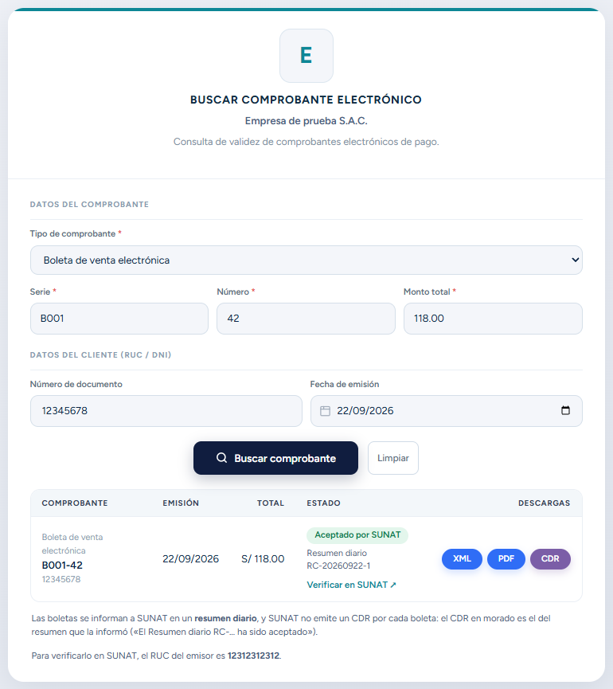
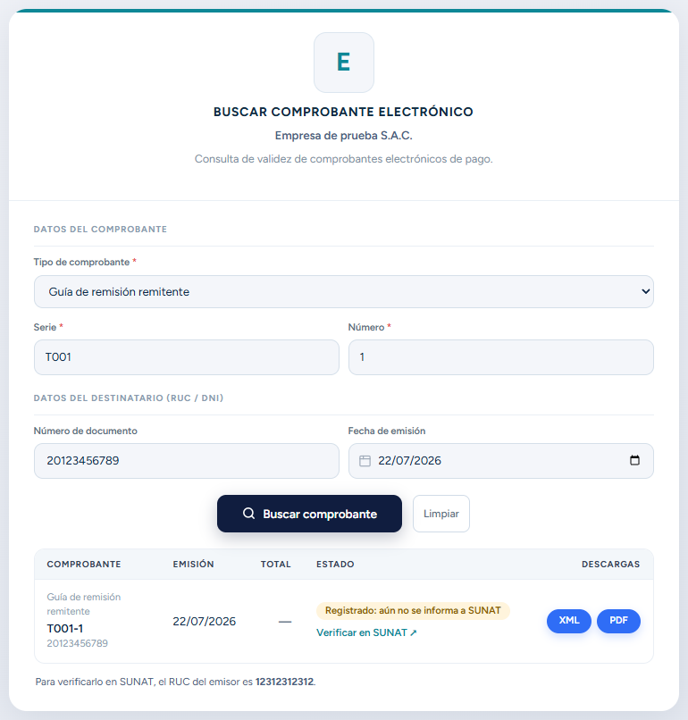
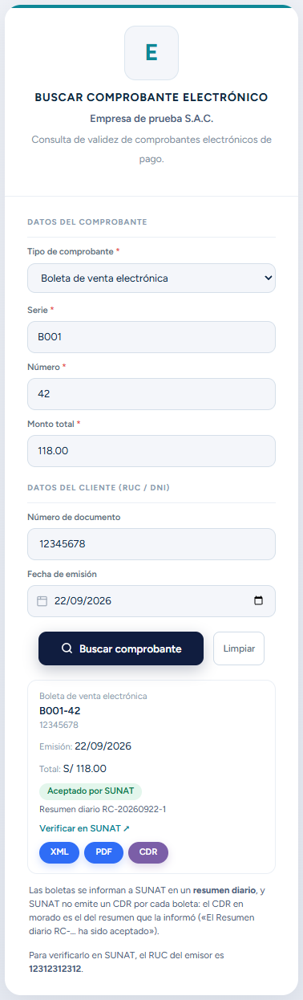

# Visualización de Comprobantes para Clientes


Para poder observar sus comprobantes recibidos.

## En la consulta pública de tu empresa

Cada empresa tiene una página pública, sin usuario ni contraseña, donde cualquiera verifica un
comprobante que le emitiste y descarga sus archivos:

```
https://<tu-dominio>/buscar
```

Es la dirección que sale impresa al pie de tus comprobantes («Para consultar el comprobante
ingresar a …»).

Se elige el **tipo de comprobante** y se completan los datos que figuran en él:

| Tipo | Datos que pide |
|---|---|
| Factura, boleta, nota de crédito o de débito | Serie, número, monto total, RUC/DNI del cliente y fecha de emisión |
| Guía de remisión remitente o transportista | Serie, número, RUC/DNI del **destinatario** y fecha de emisión (la guía no tiene monto) |



El resultado muestra:

- **El estado en SUNAT**: *Aceptado por SUNAT* (verde); *Registrado* o *Enviado*, mientras SUNAT
  todavía no lo tiene o no responde (ámbar); *Rechazado* o *Anulado*, que **no son válidos** (rojo).
- **Las descargas**: XML, PDF y el **CDR** cuando ya existe. En las boletas el CDR sale en morado:
  es el del **resumen diario** que la informó, porque SUNAT no emite uno por boleta.
- **Verificar en SUNAT**: abre la consulta de validez de SUNAT, que no pide Clave SOL. Ahí se
  ingresa el RUC del emisor, que la página muestra debajo. En una guía aceptada el enlace lleva
  directo a la guía en SUNAT.

Con la guía, el formulario cambia solo: desaparece el monto total y se pide el documento del
destinatario.



Si algún dato no coincide, la página responde «No se encontró un comprobante con los datos
ingresados», sin decir cuál. Se permiten hasta 30 consultas por minuto desde una misma conexión.

En el celular, el resultado se ve como una tarjeta:



## En el portal de SUNAT

### Boletas

Ingresa al portal de SUNAT con su clave SOL se dirige a la sección **Empresas**, en la subcategoría **Comprobantes de pago, SEE - SOL, Boleta de Venta Electrónica** y selecciona **Consultar Boleta de venta y Notas**.


Completa los siguientes campos:


:::danger IMPORTANTE:

Debe seleccionar el tipo de Consulta **BVE Recibidas**.
:::

Seguido selecciona **Aceptar**, y podrá visualizar una lista de las boletas.

### FACTURAS

Ingresa al portal de SUNAT, seguido a la sección **Empresas**, **Comprobantes de pago, Factura electrónica, Consultar Factura, Boletas y notas**.


Seguido completa los siguientes datos:


:::danger IMPORTANTE:

Selecciona el Tipo de consulta FE Recibidas.
:::
Selecciona **Aceptar** y podrá visualizar la boleta.
