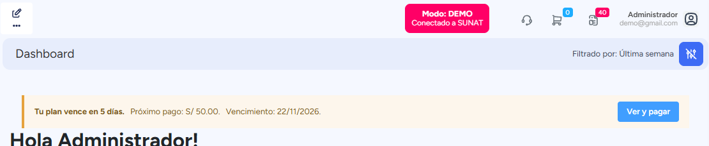
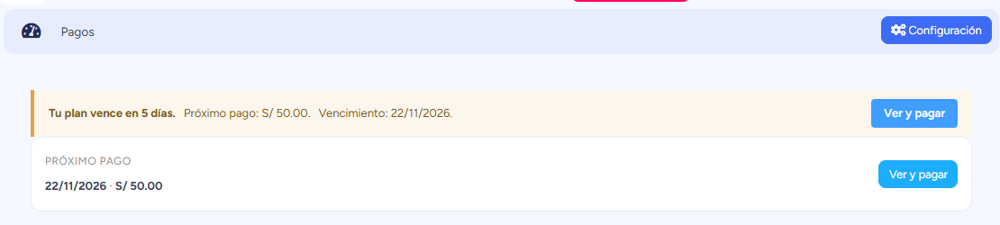
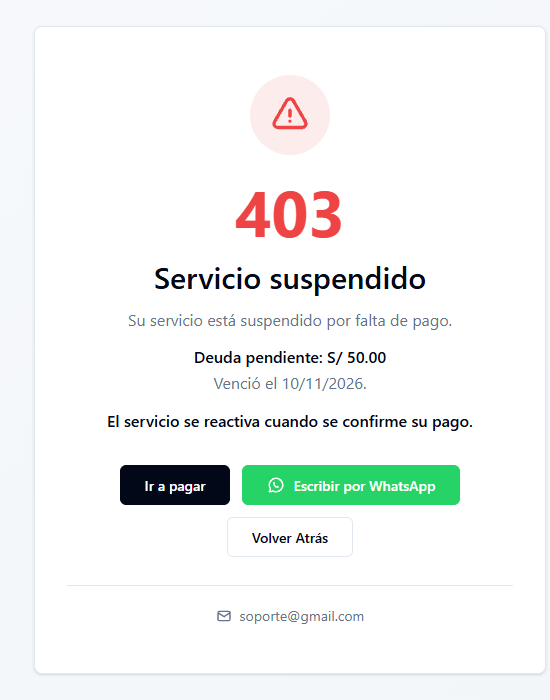

# Aviso de cobro, próximo pago y servicio suspendido

En este artículo te explicamos qué verás en tu sistema cuando se acerca la fecha de pago de tu plan, dónde
consultar cuándo toca pagar y qué hacer si el servicio queda suspendido por falta de pago. En los tres casos
el botón de pago te lleva al **estado de cuenta de tu empresa**, una página donde ves qué toca pagar, el
historial de pagos y puedes pagar sin iniciar sesión.

:::info
Estos avisos los activa la plataforma de cobro **empresa por empresa**. Si tu sistema no muestra ninguno,
no tienes nada pendiente que revisar: no es una falla.
:::

## Aviso de cobro en el panel

Cuando tu plan está por vencer o tienes un pago pendiente, aparece una franja de color en la parte superior
del panel, debajo de la barra de título. Solo se muestra en el panel de administración: nunca en el punto
de venta.

Lo que dice cada aviso:

| Aviso | Cuándo aparece | Color |
|---|---|---|
| **Tu plan vence en N días.** Próximo pago: S/ X. Vencimiento: dd/mm/aaaa. | Faltan 7 días o menos para el vencimiento | Ámbar |
| **Tienes S/ X pendiente de pago.** Con los periodos sin pagar y el vencimiento | Ya venció y hay deuda | Rojo |

Si tu cuenta tiene un convenio de pago vigente, el aviso añade una línea con la cuota que toca pagar y su fecha.

El botón **Ver y pagar** abre el estado de cuenta de tu empresa en otra pestaña. Si tu plan aún no está por
vencer y estás al día, el aviso no aparece.

## Próximo pago en «Mis Pagos»

Para consultar cuándo toca pagar sin esperar al aviso, entra a **Mis Pagos → Lista de Pagos**. Arriba verás
la tarjeta **Próximo pago** con la fecha y el monto, y el botón **Ver y pagar**.

La tarjeta se muestra aunque estés al día. Si tienes un pago vencido, dice **Pago vencido** y el monto de
lo que debes.

## Servicio suspendido

Si el servicio se suspende por falta de pago, al intentar entrar verás la pantalla **Servicio suspendido**
en lugar del sistema. Dice el motivo, cuánto debes y desde cuándo está vencido.

1. Pulsa **Ir a pagar**. Se abre el estado de cuenta de tu empresa.
2. Elige el cobro pendiente y paga con el medio que prefieras.
3. Cuando el pago se confirma, el servicio se reactiva solo. No necesitas escribir a soporte.

Si la suspensión fue por otro motivo (por ejemplo, un pedido tuyo), la pantalla dice ese motivo y los
datos de contacto de soporte, sin botón de pago.

## El estado de cuenta público

El botón de pago de las tres pantallas lleva a la misma página. **No pide usuario ni contraseña**, así que
puedes mandar el enlace a quien paga por ti (tu contador, un familiar). En ella se ve:

- el plan, el estado y el **próximo pago** con su fecha y monto;
- los cobros pendientes, cada uno con su botón **Pagar**;
- el historial de pagos;
- el WhatsApp de soporte.

Se paga con Yape, Plin, depósito o tarjeta, según los medios que tenga activos la plataforma de cobro. Si
tu plan es mensual y se ofrece el pago anual, la página también te deja elegir entre pagar cada mes o el
año completo.

:::caution
Quien tenga el enlace puede ver el nombre, el RUC, el plan y los pagos de la empresa, y puede pagar. No
muestra correos, teléfonos ni comprobantes. Compártelo solo con quien debe pagar; si se filtra, pide que lo
regeneren.
:::

## Preguntas frecuentes

**¿Por qué no veo ningún aviso?** Porque no tienes un pago próximo ni pendiente, o porque la plataforma de
cobro todavía no activó los avisos para tu empresa.

**¿El botón me pide iniciar sesión?** No. El estado de cuenta se abre directamente.

**Pagué y sigo suspendido.** Los pagos con tarjeta o con **Yape al instante** (código de aprobación) se
acreditan en el acto; los pagos con **Yape con QR**, Plin o depósito, con su número de operación, los revisa
el administrador de la cobranza y pueden tardar. Cuando se aprueban, el servicio se reactiva solo.
