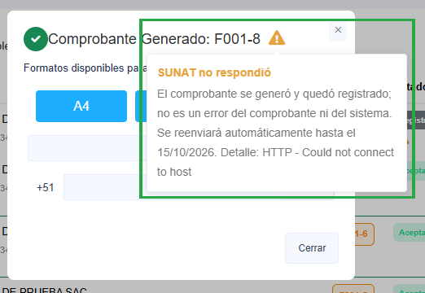
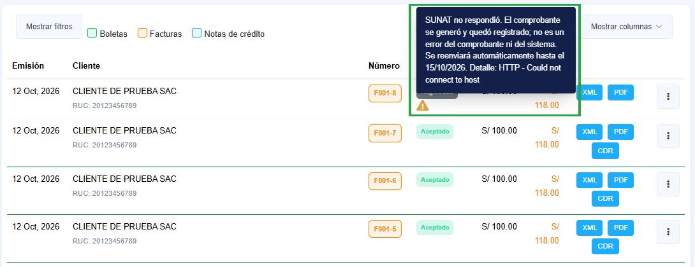
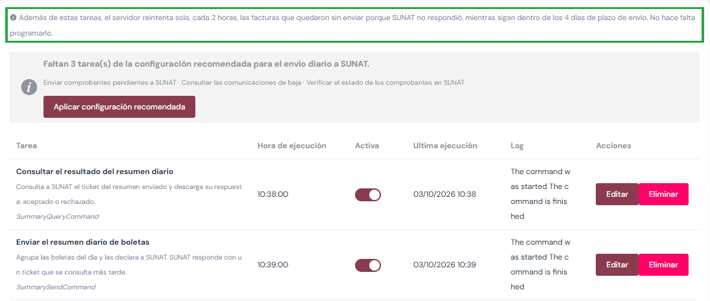

# Envío automático de facturas y el aviso «SUNAT no respondió»

:::info

Cómo se envían las facturas (y sus notas de crédito y débito) a SUNAT cuando el envío del
momento falla, qué significa cada aviso y qué papel tienen los **Días de plazo de envío**.

:::

## Al emitir: el envío del momento

Cada factura se envía a SUNAT en el mismo momento en que se emite. Si SUNAT responde, queda
**Aceptada** (o Rechazada u Observada, según lo que diga SUNAT).

Si SUNAT **no responde** (está saturada, en mantenimiento o caída), la factura **se genera
igual** y queda **Registrada**. En la ventana «Comprobante Generado» aparece un **ícono ámbar ⚠**
junto al número; al pasar el ratón por él (o tocarlo en el celular) se lee:

> **SUNAT no respondió.** El comprobante se generó y quedó registrado; no es un error del
> comprobante ni del sistema. Se reenviará automáticamente hasta el *dd/mm/aaaa*.

Lo mismo se ve en el listado de comprobantes: junto al estado **Registrado** aparece un triángulo
**ámbar**, y al pasar el ratón por él se lee el mismo mensaje. No hace falta hacer nada: el sistema
la reenvía solo.

| Aviso | Qué significa | Qué hacer |
|---|---|---|
| Ícono ámbar ⚠, «SUNAT no respondió» al pasar el ratón | El servicio de SUNAT no contestó (por ejemplo `HTTP - Error Fetching http headers`) | Nada: se reenvía sola mientras esté en plazo |
| Rojo, «Por regularizar: código - descripción» | SUNAT o el sistema encontraron algo que corregir (usuario SOL, certificado, RUC…) | Revisar el código; corregido, reenviarla |

## El reintento automático: dos mecanismos

Una factura que quedó registrada se reenvía sola por dos caminos que se complementan:

| | Reintento del servidor | Tarea de la empresa |
|---|---|---|
| **Cuándo** | Cada **2 horas** (00:25, 02:25, 04:25…) | **Una vez al día**, a la hora que tenga la tarea (la recomendada es pasada la medianoche) |
| **Qué reenvía** | Solo las facturas que fallaron porque **SUNAT no respondió** | **Todas** las facturas y notas registradas, fallaran por lo que fallaran |
| **Dónde se configura** | En ningún sitio: viene con el sistema y vale para todas las empresas | En **Tareas programadas**, como una fila más («Enviar comprobantes pendientes a SUNAT») |

Los dos reenvían solo **dentro de los Días de plazo de envío** (ver más abajo), y los dos necesitan
encendido **Configuración → Avanzado → Crontab - Tareas Programadas** (viene encendido).

El reintento del servidor **no aparece como fila** en Tareas programadas, porque no es una tarea de
la empresa. Para que no parezca que solo existe la diaria, la pantalla lo recuerda con una línea
discreta arriba. Solo se ve en las empresas en producción y sin bloqueo, que es donde corre:

En una empresa en **modo demo** esa línea no sale: el reintento solo trabaja con producción.

## Si SUNAT sí la había recibido

Puede pasar que la factura **sí llegara** a SUNAT y que lo que se perdiera fuera su respuesta. Al
reenviarla, SUNAT no la rechaza como si fuera nueva: contesta que ya la tiene, con el código
**1033** («registrado previamente»), o **1032** si la tiene **anulada o rechazada**. El sistema lo
reconoce:

- **Envío directo a SUNAT en producción:** le pide a SUNAT la constancia (el CDR) de esa factura y
  la deja en el estado que SUNAT tiene registrado (**Aceptada**, **Observada** o **Rechazada**), con
  la constancia guardada como cualquier otra.
- **Si esa consulta no es posible** (empresas con PSE u OSE, que lo resuelven por su lado, o si SUNAT
  tampoco responde a la consulta):
  - con **1033**, la factura queda **Aceptada**, sin constancia; se puede pedir después con
    **Consultar CDR**;
  - con **1032**, queda **Registrada** con el aviso rojo, para revisarla.

Nunca queda duplicada ni se pierde: SUNAT identifica la factura por su serie y número.

## Días de plazo de envío

SUNAT solo acepta una factura durante unos días desde su fecha de emisión. Pasado el plazo la
**rechaza**, y la factura se pierde. Por eso el sistema **no la reenvía sola fuera de plazo**: la
deja **Registrada** con el aviso «Venció el plazo de envío», para revisarla con su contador.

El plazo se configura en **Configuración → Avanzado → Interfaz y parámetros generales → Días de
plazo de envío**. Con el valor por defecto, **4**, se puede enviar el día de emisión y los 3 días
siguientes: una factura del 08/10 se envía hasta el 11/10.

:::warning

El botón **Reenviar** del listado sigue enviando aunque haya vencido el plazo. Si la factura está
vencida, SUNAT probablemente la rechace.

:::

## La tarea «Enviar comprobantes pendientes a SUNAT»

Es la pasada diaria de la tabla de arriba: envía **todas** las facturas y notas registradas que
sigan en plazo, también las que fallaron por otro motivo, y en su resultado (columna *Log*) lista
las que ya vencieron, por ejemplo: «enviados 1 · sin respuesta de SUNAT 0 · con error 0 · fuera de
plazo 0».

1. Ir a **Configuración** → **Configuraciones Globales** → **Avanzado** → **Tareas programadas**

2. Hacer clic en **Agregar**.
3. Seleccionar **Enviar comprobantes pendientes a SUNAT**.
4. Elegir la hora y hacer clic en **Guardar**.

:::tip Configuración recomendada
Las empresas nuevas ya traen esta tarea. Si a la tuya le falta, en *Tareas programadas* pulsa
**Aplicar configuración recomendada**: la crea con su hora, junto con las de boletas.
:::

Las boletas no se envían con esta tarea: van en el resumen diario
([Envío de boletas automático](envio-boletas-automatico.md)).
