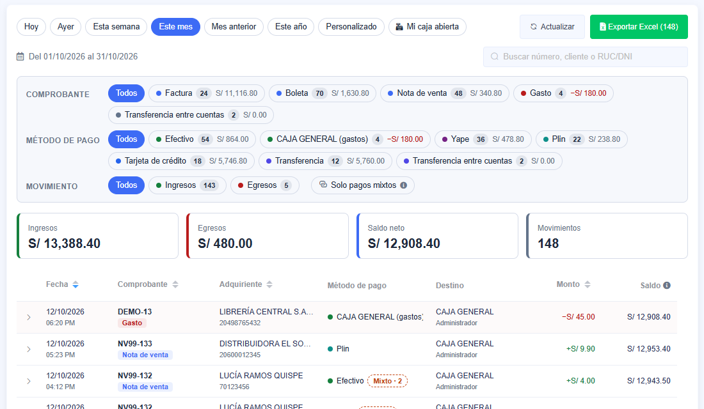
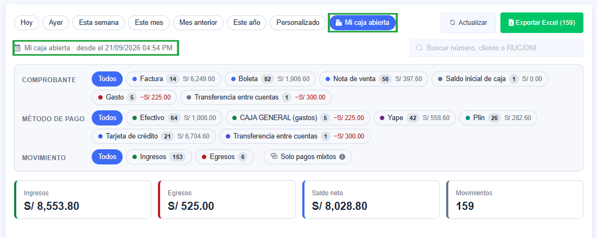
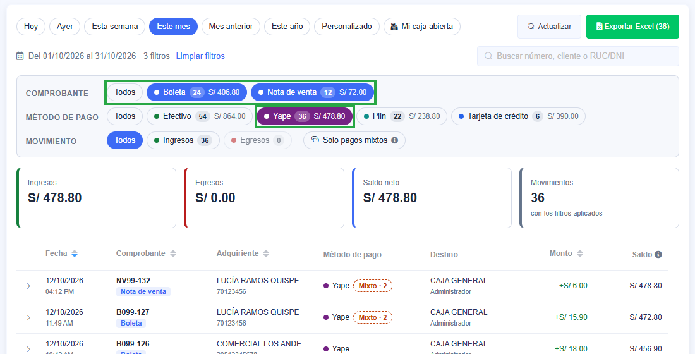
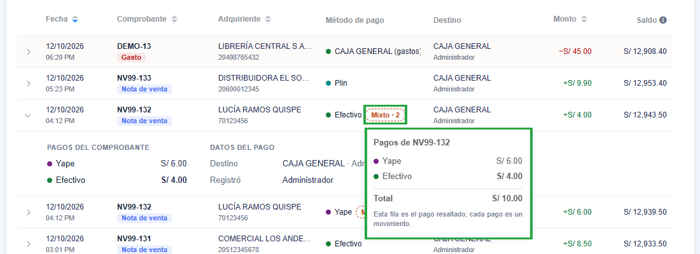
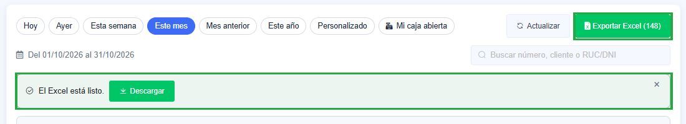
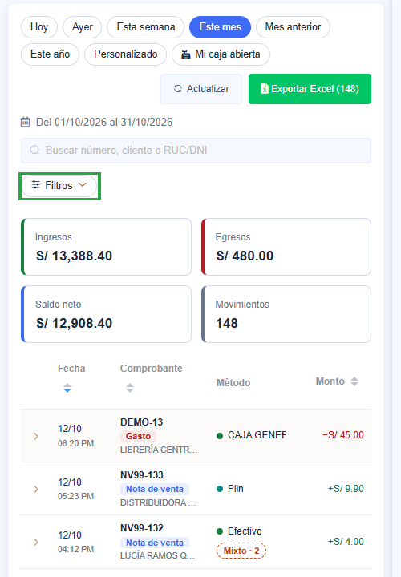

# Movimientos

En **Finanzas › Movimientos** ves todo el dinero que entró y salió en un periodo, de **todas las cajas
y cuentas bancarias**. Aparecen:

- los pagos de facturas, boletas, notas de venta, cotizaciones, contratos y servicios técnicos;
- los gastos, compras, ingresos y pagos de préstamos;
- el saldo inicial de cada caja;
- las transferencias entre cuentas.

**Cada fila es un pago.** Muestra con qué método se pagó (Efectivo, Yape, Plin, tarjeta, transferencia…),
a qué caja o cuenta llegó y el saldo acumulado.

:::info Qué ve cada usuario
- Un **administrador** ve todo.
- Un **vendedor** ve solo lo suyo: las facturas y boletas que registró o en las que figura como
  vendedor, y las notas de venta, gastos y demás que registró él.
:::

## Elegir el periodo

Arriba están los periodos: **Hoy**, **Ayer**, **Esta semana**, **Este mes**, **Mes anterior** y **Este año**.
Con **Personalizado** eliges un rango de fechas. Debajo de los periodos se lee cuál estás viendo.

**Mi caja abierta** muestra solo lo que entró o salió de **tu caja abierta**, desde que la abriste, sin
importar el periodo. Si no tienes una caja abierta, la pantalla te avisa y muestra el periodo que tenías
elegido.

## Filtrar con los chips

Debajo del periodo hay tres grupos de chips:

| Grupo | Qué filtra |
|---|---|
| **Comprobante** | Factura, Boleta, Nota de venta, Nota de crédito, Gasto, Compra, Saldo inicial de caja, Transferencia entre cuentas… |
| **Método de pago** | Efectivo, Yape, Plin, Tarjeta, Transferencia… los que use tu empresa. |
| **Movimiento** | Ingresos o egresos. |

- **Puedes marcar uno, varios o ninguno.** «Todos» quita el filtro de ese grupo. La tabla y los totales se
  actualizan al instante: no hay que pulsar «Buscar».
- **Solo salen los chips que tienen movimientos en el periodo.** Cada uno dice cuántos movimientos hay y
  cuánto suman.
- **Cada chip cuenta lo que verías si lo marcaras.** Si eliges **Yape**, el chip **Boleta** dice cuántas
  boletas se pagaron con Yape y por cuánto.
- **Solo pagos mixtos** deja los comprobantes pagados con más de un método.
- **La búsqueda** encuentra por número (`B001-5436`), por nombre del cliente o proveedor, o por RUC o DNI.
- **Limpiar filtros** quita todos los filtros menos el periodo.

Los filtros quedan en la dirección de la página: al recargar se mantienen, y puedes compartir el enlace
con otra persona que tenga acceso.

:::tip Métodos de los gastos
Los gastos usan su propio catálogo de métodos, como «CAJA GENERAL». Por eso llevan **(gastos)** al lado:
así no se confunden con un método de ventas que se llame igual.
:::

## Comprobantes pagados con varios métodos

Si un comprobante se pagó con más de un método, sale **una fila por cada pago**, y cada una lleva la
marca **Mixto · 2**. Por ejemplo, una boleta de S/ 45.90 pagada con Efectivo S/ 30.00 y Yape S/ 15.90 da
dos filas. Así el total de cada método es exacto.

- Pulsa **Mixto · 2** para ver todos los pagos del comprobante. El de esa fila sale resaltado.
- Pulsa la flecha de la izquierda para desplegar la fila. Ahí ves:
  - los pagos del comprobante;
  - el detalle de un gasto o ingreso;
  - el destino y la referencia de la operación;
  - el monto original y el tipo de cambio, si fue en dólares;
  - la fecha de emisión, si se cobró otro día;
  - quién lo registró.

## Totales y saldo

- **Ingresos, Egresos, Saldo neto y Movimientos** suman **todo lo filtrado**, no solo la página que ves.
- **Monto**: en verde con «+» si es un ingreso, en rojo con «−» si es un egreso.
- **Saldo**: el acumulado de lo filtrado en orden cronológico. La primera fila, la más reciente, muestra
  el saldo final.
- **Dólares**: lo cobrado o pagado en dólares se pasa a soles con el tipo de cambio del comprobante.
- **Orden y páginas**: puedes ordenar por fecha, comprobante, adquiriente o monto, y ver 25, 50 o 100
  movimientos por página.

## Exportar a Excel

**Exportar Excel** descarga lo que tienes filtrado: el mismo periodo, los mismos chips y la misma
búsqueda. El botón dice cuántos movimientos va a llevar.

El archivo se arma **en segundo plano**, así que puedes seguir trabajando. Cuando está listo aparece
**El Excel está listo** con el botón **Descargar**. También queda en la **bandeja de descargas** (el
ícono de descarga de arriba).

El Excel trae dos hojas:

- **Movimientos**, una fila por pago, con estas columnas:
  - fecha, fecha de emisión (si se cobró otro día), tipo y número del comprobante;
  - adquiriente o proveedor y su documento;
  - **método de pago** y **pagos del comprobante** (por ejemplo `Efectivo 30.00 + Yape 15.90`), y si fue
    pago mixto;
  - destino, referencia, moneda, monto original y tipo de cambio;
  - ingreso, egreso y saldo en soles;
  - usuario y detalle.

  Arriba lleva la empresa, el establecimiento y los filtros que usaste.
- **Resumen**, con lo que entró y salió por cada método de pago y por cada tipo de comprobante.

## En el celular

- Los filtros se pliegan en el botón **Filtros**, que muestra cuántos tienes activos.
- La tabla deja a la vista la fecha, el comprobante con su cliente, el método y el monto. Despliega una
  fila para ver el destino y el saldo.

