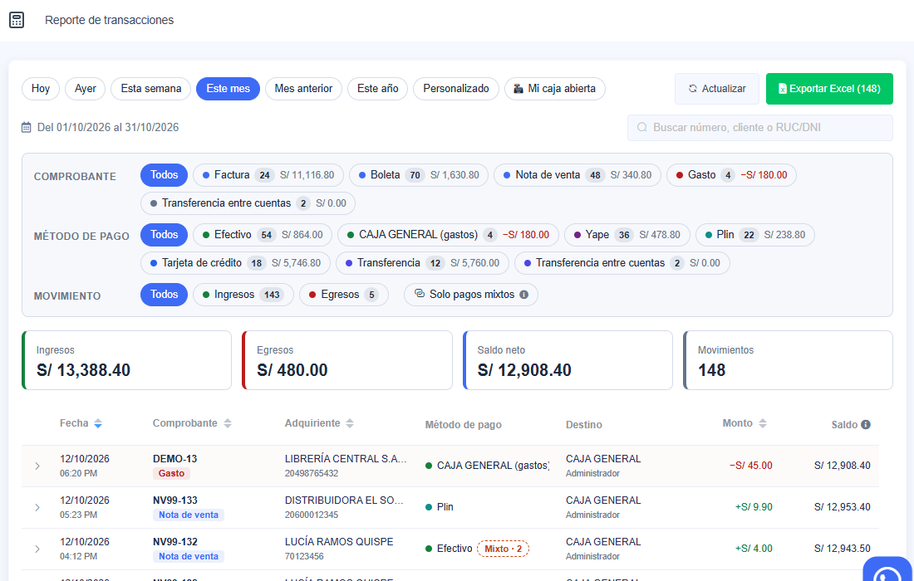

# Transacciones

**Finanzas › Transacciones** es el mismo libro que [Movimientos](01-Movimientos.md): todo lo que entró y
salió de tus cajas y cuentas bancarias, un pago por fila, con su método de pago, su destino y el saldo
acumulado.

Funciona igual que Movimientos:

- se elige el periodo o **Mi caja abierta**;
- se filtra con los chips de comprobante, método de pago y movimiento;
- se busca por número, cliente o RUC/DNI;
- se exporta a Excel lo filtrado.

Cómo se usa cada cosa: en [Movimientos](01-Movimientos.md).

