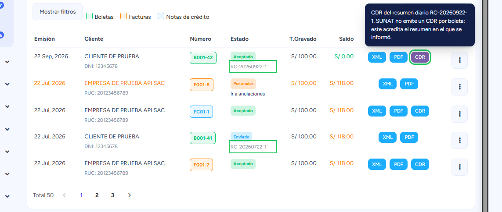
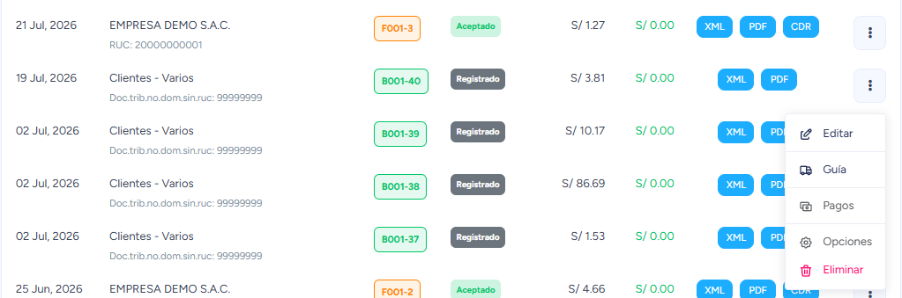
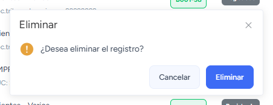

# Lista de Comprobantes 

En esta área podrás conocer las acciones que puede realizar en el módulo lista de comprobantes.

Ingresa al **módulo de ventas** y luego ir a **Listado de Comprobantes**.

## Botones de acción

En esta sección te explicaremos la función de cada botón enumerado.

**1. Nuevo:**
Al seleccionar el botón **Nuevo**, aparecerá el formulario para crear un nuevo comprobante de pago.Te invitamos a leer nuestro artículo **[Nuevo Comprobante](./01-nuevo-comprobante.md)**, donde te explicaremos paso a paso,como realizarlo.

**2. Reporte de Pago:**
Al seleccionar el botón desplegable, podrás generar el reporte de los pagos que se hayan realizado,y también descargarlos.

Observaremos las siguientes subcategorías:

- **Genera un reporte:** Seleccione el periodo de fechas de los reportes a descargar y el tipo de formato **PDF/ Excel**. Posteriormente selecciona el botón **descargar.**

- **Descargar Excel:** Seleccione el periodo de fechas de los reportes a descargar. Posteriormente selecciona el botón descargar.

**3. Validación masiva**
En esta sección se corroborará que los comprobantes electrónicos, tanto en la plataforma como en SUNAT,presenten el mismo estado.

Al seleccionar el botón **✓Validación masiva** nos aparecerá el formulario.

Se procederá a ingresar los siguientes datos:

- **Periodo**
- **Mes**
- **Tipo de comprobante**

Después selecciona el botón **Buscar y Validar**.

**4. Mostrar/Ocultar ventanas**
En esta área podrás modificar la tabla que te aparece por defecto; se pueden añadir por columnas.

**5. Filtros de búsqueda**
En esta área podremos buscar cualquier tipo de comprobantes de pago.

Al seleccionar el botón **[+Ver más]** donde nos aparecerá el formulario

Se puede filtrar la lista mostrada por los siguientes datos:

- **Tipo de comprobante**
- **Serie**
- **Número**
- **Fecha de Inicio**
- **Fecha término**
- **Clientes**
- **Productos**
- **Categoría**
- **Fecha de emisión**
- **Estado**
- **Orden de compra**
- **Número de Guia**
- **Placa**
- **Pend. de pago**

Después selecciona el botón **GUARDAR**, donde visualizará la lista de comprobantes que ha filtrado.

**6. Otras acciones**
**Comprobantes de SUNAT**

Puedes descargar los comprobantes en diferentes formatos:

- **XML,** un archivo encriptado emitido por SUNAT(✓)
- **PDF,** archivo pdf del documento seleccionado (✓)
- **CDR,** la constancia de recepción de SUNAT. Aparece cuando el comprobante ya fue aceptado.

#### El CDR de las boletas

SUNAT no emite un CDR por cada boleta: las boletas (y sus notas de crédito y débito) se informan en
un **resumen diario**, y SUNAT responde al resumen con un solo CDR que dice *«El Resumen diario
RC-…, ha sido aceptado»*. Por eso, en el listado:

- Debajo del estado de la boleta se ve el **resumen** con el que se informó (`RC-20260922-1`). Si
  la boleta está **Enviada**, es el resumen que todavía espera respuesta de SUNAT.
- Su botón **CDR** sale en **morado**: descarga el CDR de ese resumen (`R-<RUC>-RC-….zip`). Al pasar
  el mouse se ve de qué resumen es. En una boleta **Anulada**, es el CDR del resumen que la anuló.
- El **CDR azul** es el propio del comprobante: facturas, sus notas y las boletas de envío
  individual.

El CDR del resumen se puede entregar al cliente sin problema: no nombra las demás boletas, ni a
sus clientes, ni sus montos. Lo que sí las lista es el XML del resumen, que no se entrega.

Tu cliente también puede descargarlo él mismo, junto con el XML y el PDF, desde la
[consulta pública de comprobantes](../../../guias-adicionales/Facturacion/Donde-pueden-ver-mis-clientes-los-comprobantes-que-les-emiti.md).

**Botón lado derecho 3 puntos desplegables**

- **Guía:** En esta sección seras rediccionado al modulo **Guias de Remision** donde podrás emitir guías de remisión y quedarán enlazadas con el comprobante, asimismo se completaran automáticamente los campos Cliente y Productos.

  Para el sentido contrario —emitir primero la guía y facturarla después— mira **[Generar comprobante desde una guía](../../Complementarios/guias-de-remision/03-Generar-comprobante-desde-una-guia.md)**.

- **Anular:** En esta sección podrás anular comprobantes electrónicos de manera directa, mira nuestro artículo aquí, donde te enseñaremos a realizarlo paso a paso.

- **Opciones:** En esta sección podrás reimprimir el comprobante de pago, enviarlo a correo electrónico o whatsapp. Además podrás escoger el formato del comprobante electrónico en tamaño **A4(vertical), 80MM (ticket) y A5(horizontal)**.

- **Pago:** En esta sección podrás gestionar los pagos pendientes,caso contrario la ventana a mostrar estará vacia.

- **Eliminar:** borra una boleta o una factura que todavía no salió a SUNAT. Solo aparece a los
  usuarios con el permiso de ese tipo; ver [Eliminar una boleta o factura registrada](#eliminar-una-boleta-o-factura-registrada).

## Eliminar una boleta o factura registrada

La opción **Eliminar** aparece en:

* una **boleta** en estado **Registrado** que no va en ningún resumen diario, a los usuarios con
  el permiso **Eliminar boletas registradas**;
* una **factura** en estado **Registrado**, a los usuarios con el permiso **Eliminar facturas
  registradas**.

Los dos permisos vienen desmarcados para todos; el administrador los da a quien quiera desde
**Configuración y más → Usuarios → Editar → Permisos → Comprobantes**
([cómo se dan los permisos](../../configuracion-y-mas/usuarios/agregar-usuarios-a-mi-sistema.md#eliminar-boletas-y-facturas-registradas)).
En notas de crédito y débito, y en boletas y facturas que ya se enviaron, no aparece: esas se
anulan.

Abre el menú de tres puntos del comprobante y elige **Eliminar** (en una factura es igual):

El sistema pide confirmación antes de borrar:

Al eliminarlo se borran también sus pagos, y el stock de los productos vuelve. **No se puede
deshacer.** Si era el último de su serie, el número vuelve a quedar libre; si no, queda un salto
en la numeración que SUNAT nunca recibió. Una factura que ya tiene una nota de crédito o débito
no se puede eliminar.

**Facturas y boletas con envío individual.** Las facturas se envían a SUNAT una por una al
emitirse, y lo mismo las boletas si la empresa usa el envío individual. Si una quedó en
Registrado, lo normal es que el envío fallara o tardara demasiado, y en ese caso SUNAT pudo
haberla recibido igual. Por eso, en producción, antes de eliminarla el sistema le pregunta a SUNAT
si la tiene, y solo la borra si SUNAT contesta que no:

- Si SUNAT la tiene, no se elimina: usa **Reenviar** para que su estado se actualice.
- Si la consulta no responde, no se elimina: inténtalo de nuevo en un momento.
- Para poder preguntar, la empresa necesita el **client_id** y el **client_secret** de la
  consulta integrada de SUNAT. Sin ellos, no se elimina.
- Si la empresa envía por un PSE u OSE, no se elimina desde aquí: verifícala en tu proveedor y usa
  **Reenviar**.

Las boletas que esperan su resumen diario no salieron a SUNAT: se eliminan sin preguntar.

Lo mismo se puede hacer por API, con las mismas reglas; el usuario dueño del token necesita el
mismo permiso:
[Eliminar - Boleta o factura registrada](../../../devs/api/tenant/Generar-boleta/eliminar-boleta.api.mdx).
