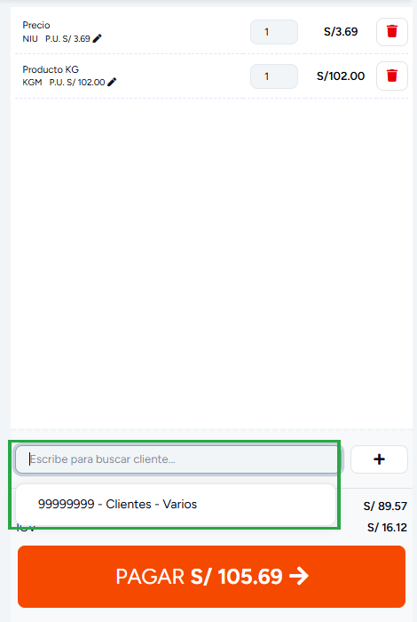
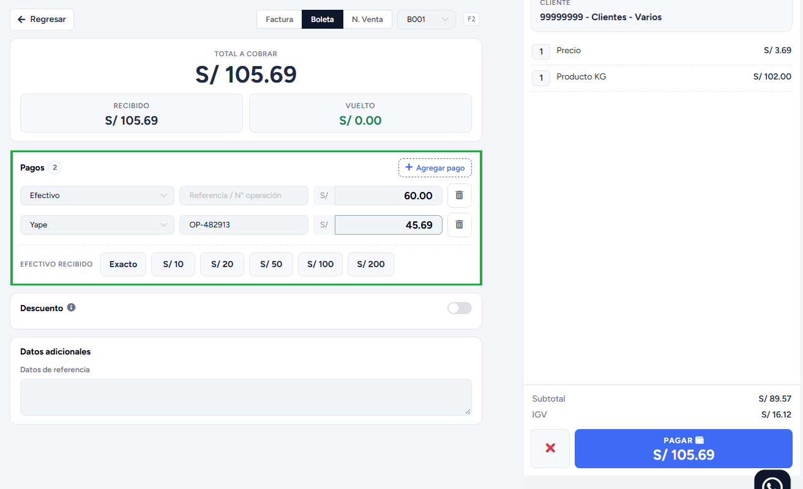

# Puntos de venta

En esta área te ayudaremos a como gestionar tu punto de venta de la manera más práctica y eficaz. Sigue estos pasos para realizarlo:

## Módulo 
Ingresa al módulo **Ventas** , en la subcategoría **Punto de venta**. Se visualizarán las categorías de los productos.

Principalmente, encontraremos varias secciones y botones:

1. Activa el botón deslizable para buscar con  el escáner de código de barras
2. Podrás seleccionar diferentes tipos de vista de los productos
3. Se visualizarán las categorías de los productos
4. Selecciona el cliente. Al hacer clic en **Escribe para buscar cliente...** aparecen **Clientes - Varios** y los últimos clientes que usaste, sin escribir nada. Para buscar otro, escribe al menos 3 caracteres de su nombre o de su número de documento. Con el botón **[ + ]** creas un cliente nuevo, y con el botón **[ S/ ]** cambias la moneda de soles a dólares. Si marcas la casilla **Defecto**, cada venta empieza con *Clientes - Varios* ya seleccionado.

   

5. En esta sección estarán agregados los productos que se venderán. Cada clic en un producto lo agrega arriba de la lista, y si ya estaba, le suma uno a la cantidad. El catálogo no se mueve de donde estabas, así que puedes seguir agregando sin volver a buscar.
6. Se visualizarán los datos del precio del producto.
7. En esta sección se visualizará el monto total a cobrar, para continuar deberás seleccionar el botón **Pagar**
Nos redirigirá a otra ventana:

## Pantalla de pago

8. Arriba eliges el comprobante (**Factura / Boleta / N. Venta**) y su serie. La tecla **F2** cambia de comprobante sin usar el mouse. **Regresar** vuelve al carrito sin perder lo que ya llenaste.

9. La tarjeta **Total a cobrar** muestra el monto de la venta, lo **Recibido** y el **Vuelto** (en verde) o lo que **Falta** (en rojo).

10. En **Pagos**, cada pago es una fila: el método de pago (se elige en la lista desplegable), el destino del dinero (la caja o una cuenta bancaria, solo si tienes cuentas registradas), una referencia opcional (por ejemplo, el número de operación) y el monto. Todo se edita ahí mismo, sin abrir otra ventana. Escribe en el monto lo que te entregó el cliente y presiona **Enter** para cobrar.

11. Para dividir el pago (por ejemplo, una parte en efectivo y otra con Yape), baja el monto de la primera fila y pulsa **+ Agregar pago**: la fila nueva ya trae lo que falta. Con el ícono de tacho **[ 🗑 ]** quitas una fila.

12. Si el pago es en **Efectivo**, debajo de los pagos están los billetes (**S/ 10, 20, 50, 100 y 200**). Haz clic en cada billete que te entregue el cliente: se van sumando (por ejemplo, 50 + 50 + 10 = S/ 110) y el vuelto se calcula solo. **Exacto** deja justo lo que falta. Si escribes un monto a mano, los billetes que pulses después se suman a ese monto.

13. **Descuento**: activa el interruptor, elige **Monto** o **Porcentaje** y escribe el valor. Si tu usuario es vendedor y la empresa restringe los descuentos, esta sección no aparece.

14. **Propina** (solo si está activada en la configuración): el nombre del empleado y el monto. En **Datos adicionales** van el vendedor (si la empresa trabaja con vendedores), los datos de referencia y el N° de placa (según el giro del negocio).

15. En el resumen se ven los productos, el subtotal, el IGV y el total a pagar. Si el cliente tiene puntos, ahí mismo puedes canjearlos por producto. **Pagar** emite el comprobante y la **X** cancela la venta. Mientras falte dinero, **Pagar** queda deshabilitado.

Posteriormente al seleccionar el botón **Pagar,** aparecerá una nueva venta indicando que la venta ha sido exitosa.

Asimismo puedes imprimir el comprobante en formato **ticket /A4 /A5,** finalmente puedes enviarlo por **correo electrónico o WhatsApp**, ingresando el dato del destinatario y seleccionando el botón **Enviar**.

