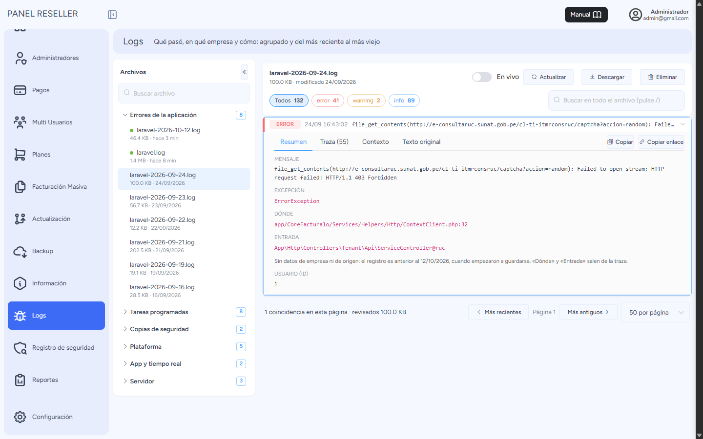
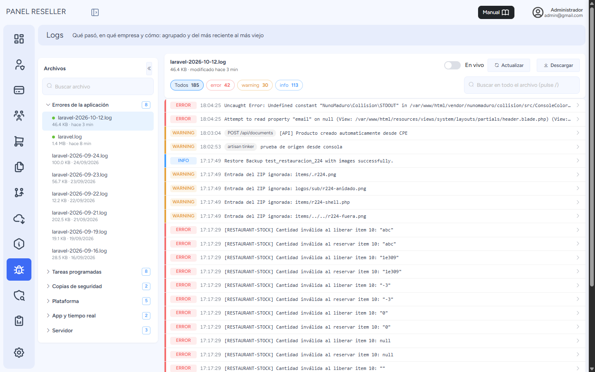

# Logs

El área de logs es de suma importancia ya que agrupa los errores generados en el sistema de facturación con este historial podremos detectar con mayor rapidez la solución para apoyar a nuestros clientes.
Podrás ubicarlo siguiendo estos pasos:

Iniciamos entrando a nuestro sistema **Administrador** donde visualizaremos el **módulo de Logs**.

## Vista del Log

Solo lo ve el **superadministrador**: los logs llevan datos de todas las empresas.

- **A la izquierda, los archivos agrupados** por tipo: *Errores de la aplicación*, *Correos*,
  *Tareas programadas*, *Copias de seguridad*, *Plataforma*, *App y tiempo real*, *Servidor* y
  *Archivados* (los recortes comprimidos `.gz` que guarda la limpieza semanal). Dentro de cada grupo
  van del más reciente al más viejo, con su tamaño y cuándo se escribieron; el punto verde marca los
  que se están escribiendo hoy. La columna se oculta con la flecha **«** de su esquina y vuelve con el botón **Archivos**.
- **Arriba, cuántas hay de cada nivel** (*Todos*, *error*, *warning*, *info*…): al pulsar uno se
  filtra. El buscador busca en **todo el archivo**, no solo en lo que se ve. **En vivo** refresca la
  primera página cada 10 segundos.
- **Cada fila** es una entrada: nivel, hora, la **empresa** donde pasó (al pulsarla se filtra por
  ella), el **origen** (la URL, el comando o la tarea) y el mensaje.
- **Al pie**, la paginación: **Más recientes** / **Más antiguos**, y 25, 50 o 100 por página. Si una
  búsqueda no encuentra nada en lo revisado, **Seguir buscando** continúa hacia atrás.

## Detalle de un error

Al pulsar una fila se despliega su detalle:

- **Resumen**: el mensaje, la excepción, **Dónde** (la línea del código del sistema donde falló) y
  **Entrada** (la pantalla, API, comando o tarea por la que llegó). Debajo, la **empresa**, el
  **origen**, el usuario, la IP y el *Request ID*, que cruza esta línea con el registro de seguridad.
  Los registros anteriores al 12/10/2026 no traen empresa ni origen: se guardan desde esa fecha.
- **Traza**: las llamadas, con las del sistema resaltadas y las del framework plegadas.
- **Contexto** y **Texto original**, con **Copiar** y **Copiar enlace**. El enlace abre el visor en
  esa misma entrada: sirve para pasársela a soporte.

## Eliminar un log

Los logs de **días anteriores** y los **archivados** tienen **Eliminar** (en la barra o con la
papelera al pasar el ratón por el archivo). Pide confirmación y queda anotado en el *Registro de
seguridad*. El log de hoy y los que se siguen escribiendo no se pueden eliminar ni vaciar: son lo que
está pasando ahora, y su tamaño ya lo controla la limpieza semanal.

## Menú lateral plegado

El botón junto al nombre del panel pliega el menú a solo iconos (el nombre aparece al pasar el
ratón) y deja más ancho para los logs. Se recuerda entre páginas.

