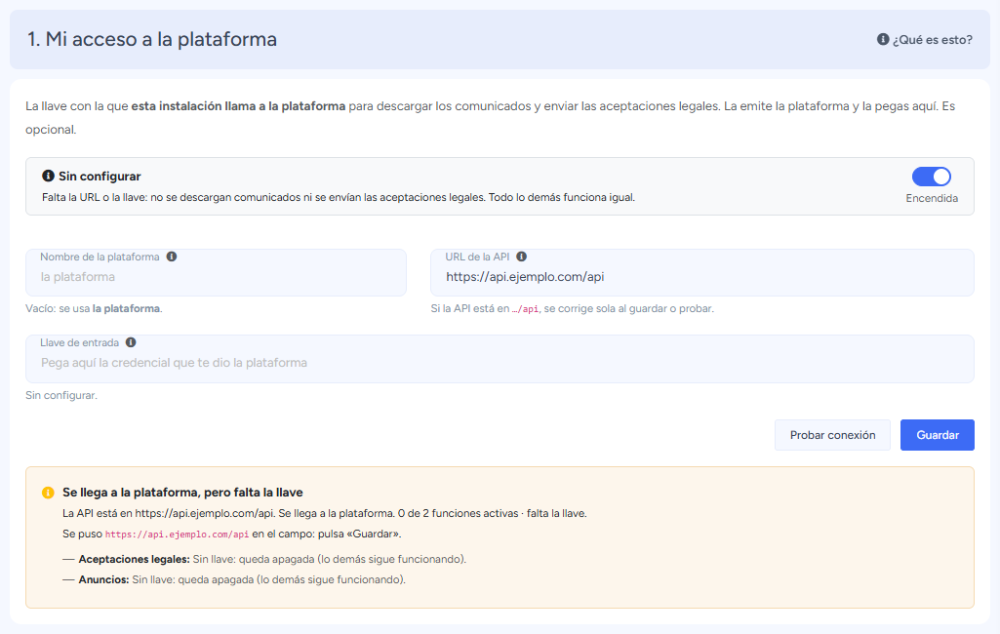
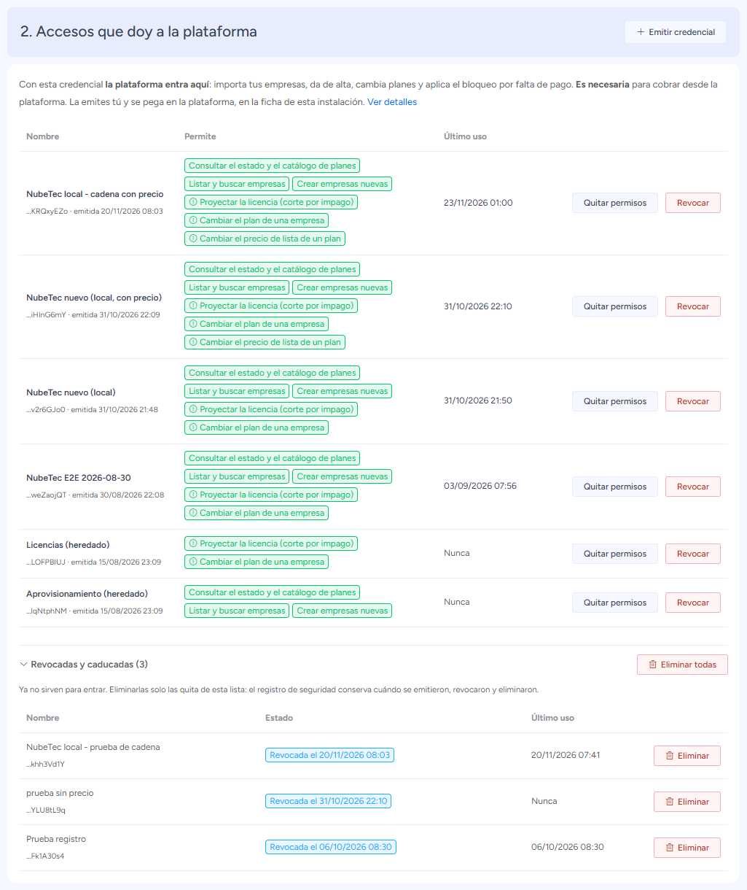

# Integración con la plataforma de cobro

En el menú **Integración** del panel administrador están las dos credenciales que unen esta
instalación con la plataforma que cobra las suscripciones. Van en sentidos opuestos y cada una se
pega en el lado contrario al que la emite:

| | Quién la emite | Dónde se pega | Para qué | ¿Hace falta? |
|---|---|---|---|---|
| **1. Mi acceso a la plataforma** | La plataforma (Instancias → «llave de entrada») | Aquí | Descargar los comunicados y enviar las aceptaciones legales | Opcional |
| **2. Accesos que doy a la plataforma** | Esta instalación («Emitir credencial») | En la plataforma, en la ficha de esta instalación | Importar las empresas, cambiar planes y aplicar el bloqueo por falta de pago | **Sí**, para cobrar desde la plataforma |

En la parte de arriba de la tarjeta, el nombre que pongas en **Nombre de la plataforma** es el que
dicen los títulos de esta pantalla y el listado de clientes.

## 1. Mi acceso a la plataforma

- **El estado y el interruptor** van arriba: *Conectada*, *Configurada* (aún sin probar),
  *Sin configurar*, *Sin conexión* o *Apagada*. Apagarla no borra la llave.
- **URL de la API**: la dirección de la API, no la de la web. **Basta el dominio**: si la API está en
  `…/api`, el sistema lo detecta al guardar o al pulsar **Probar conexión** y la guarda así.
- **Llave de entrada**: la que muestra la plataforma una sola vez al crear la instancia o al pulsar
  «Nueva llave de entrada». Vacío al guardar = se mantiene la que había.
- **Probar conexión** comprueba que se llega a la API y qué permite la llave (aceptaciones legales y
  anuncios). El resultado queda en el recuadro de abajo: verde si todo funciona, ámbar si se llega
  pero falta la llave, rojo si algo falla y con el motivo.

## 2. Accesos que doy a la plataforma

- **Emitir credencial**: se le pone un nombre y se marcan solo los permisos que la plataforma vaya a
  usar (los que pueden bloquear o cambiar planes y precios llevan el aviso *Disruptivo*). El valor se
  muestra **una sola vez**: se copia y se pega en la plataforma.
- **Quitar permisos** retira casillas al instante. Para añadir una hay que emitir otra credencial y
  revocar la anterior.
- **Revocar** corta el acceso de inmediato.
- **Revocadas y caducadas** quedan plegadas debajo. Ya no sirven para entrar y se pueden **Eliminar**
  una a una o con **Eliminar todas**. Una credencial activa no se puede eliminar: primero se revoca.
  El registro de seguridad conserva cuándo se emitió, revocó y eliminó cada una.
